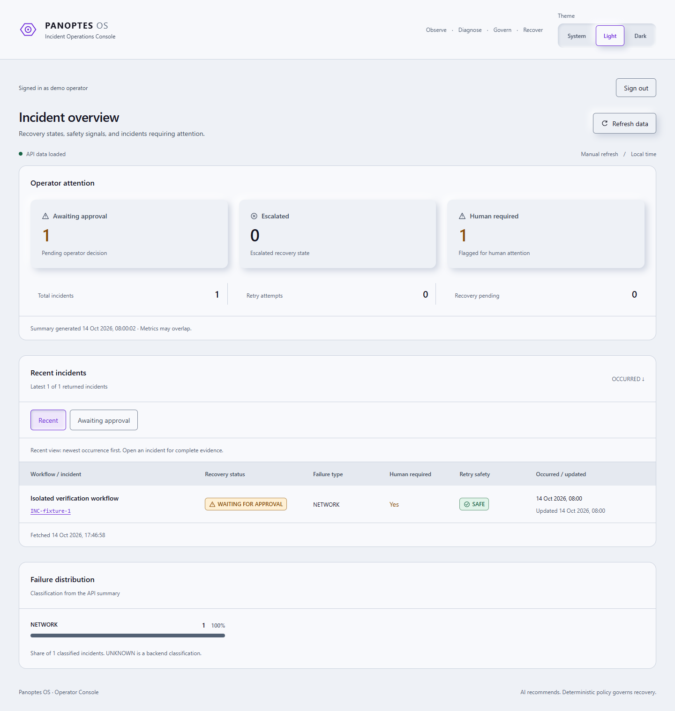

# Panoptes OS

Incident operations for n8n automations: observe failures, diagnose from execution evidence, apply deterministic recovery policy, and bring an operator into decisions that need approval.

**v1 is frozen.** Panoptes OS v1 is deployment-ready and locally verified in production mode. Always-on public hosting is intentionally not maintained for this US$0/month portfolio project.

## Why it exists

A failed automation is more than an error notification. An operator needs to know what failed, whether repeating the operation could duplicate side effects, who authorized recovery, and what happened afterward. Panoptes brings that evidence, policy and decision history into one console.

## Capabilities

- Deterministic incident identity, normalized failure evidence and persisted event history.
- Structured AI diagnosis with validated output and no execution authority.
- Trusted workflow configuration, retry budgets and independent safety gates.
- Human APPROVE/REJECT decisions with confirmation and backend reconciliation.
- Light/Dark/System Operator Console: summary, incident lists, Explorer, recovery details and timeline.
- Supabase operator authentication, allowlisted gateway access and a compiled production static/API server.

## How it works

```text
Failed execution → Error Intake → evidence → AI diagnosis → deterministic policy
                                                        ├─ escalate
                                                        ├─ human approval
                                                        └─ guarded retry → verify → persist outcome
Operator Console → authenticated Node gateway → n8n operator workflows → Supabase
```

Incidents begin as NEW and branch toward ESCALATED, WAITING_FOR_APPROVAL or recovery. A retry is not recovery success: verification distinguishes RECOVERED, pending work and escalation. Incident rows track current state; event records retain decision and recovery evidence.

**AI recommends; deterministic policy governs recovery.** AI cannot change budgets, credentials, permissions or trusted idempotency, approve a decision, or execute a retry. Human approval also cannot override an UNSAFE classification or exhausted retry budget. [Architecture and lifecycle](docs/architecture.md) explain the separate policy and execution gates.

## Operator Console



[Dark dashboard](screenshots/dashboard-dark.png) · [Incident Explorer](screenshots/incident-explorer.png) · [Approval confirmation](screenshots/approval-confirmation.png) · [Login](screenshots/login.png)

All screenshots use synthetic local fixtures. Visible operator identity is replaced with a demo label for capture; no decision is submitted. [Screenshot provenance](screenshots/README.md).

## Security and reliability

Every gateway API request verifies the Supabase bearer token and server-side operator allowlist. Approval requests contain only incident ID and decision; the gateway derives operator identity and injects internal Header Auth. The browser does not query application tables or receive backend credentials.

Fixed routes, strict contracts, bounded requests/responses, fail-closed configuration and independent retry gates limit authority. Approval POSTs are never automatically retried. A lost acknowledgement remains uncertain and requires reading backend state before another deliberate action. Future hosted operation requires restricted n8n ingress as well as HTTPS; CORS is not that boundary. [Security details and limitations](docs/security.md).

## Stack and verification

React 19 · TypeScript · Vite · Fastify/Node 24 · Supabase Auth/Postgres · n8n · Groq · Playwright · Docker

| Selected milestone | Recorded result |
| --- | --- |
| M17.3 interface | 233 frontend checks; 115 proxy/security checks |
| M18.2 boundary/reliability | 19 gateway tests; 142 isolated browser assertions; separate real read-only smoke |
| M18.3 local production freeze | 24 gateway/static-security tests; 170 browser assertions; 16 container checks |

Counts overlap and are not combined. Historical live M17.2 actions, user-executed database permission evidence, synthetic tests and real read-only flows have separate provenance in [testing](docs/testing.md). Hosted verification was not performed. [M19.1 publication validation](docs/publication.md) records the current packaging checks.

## Local setup

Use Node 24 and npm. External prerequisites are a configured n8n backend, the Panoptes database objects, Groq access and a Supabase Auth project. [Sanitized workflows and import mappings](workflows/README.md) are included; a complete database migration and fresh-instance import verification are not. Cloning this console does not provision the backend.

1. Run `npm ci`.
2. Copy `.env.example` to ignored `.env.local` without overwriting existing credentials.
3. Set matching browser/server Supabase URL and publishable key. Never use a secret/service-role key.
4. Manually provision Auth operators, disable public signup/anonymous sign-in, and set their UUIDs in server-only `PANOPTES_OPERATOR_IDS`.
5. Set the upstream origin, console origin and server-only approval Header Auth to match the configured backend.
6. Run in separate terminals:

```text
npm run dev:api
npm run dev
```

Open `http://127.0.0.1:5173`. The gateway defaults to loopback port 3001. Browser calls remain fixed to `/api/panoptes`; Vite proxies only to the gateway. Restart both processes after changing `PANOPTES_GATEWAY_PORT`. For a Windows config-loader EPERM, use `npm run dev -- --configLoader runner`.

The examples document configuration placement: `VITE_*` Auth settings are public build inputs; operator IDs, upstream configuration and approval credentials are server-only. Origins accept no path, credentials, query or fragment. Production requires HTTPS. Do not put private values into tracked examples. [Production configuration map](docs/production.md).

## Production readiness and project status

Build with `npm run build` and `npm run build:server`, then supply runtime configuration and start the compiled process with `NODE_ENV=production`. It serves the verified frontend and API together; Vite/preview are development tools. [Production requirements](docs/production.md) cover container operation, HTTPS, restricted ingress and runtime secrets.

No public deployment, always-on service, hosted verification or real-client usage is claimed. Complete zero-cost hosting, a separate production Supabase project and hosted migration remain deferred. The [v1 freeze](docs/v1-freeze.md) preserves the historical acceptance boundary. M19.1 packages public documentation and assets; application features and backend behavior remain frozen.

## License

[MIT License](LICENSE) · Copyright (c) 2026 Marvin Silverio.
