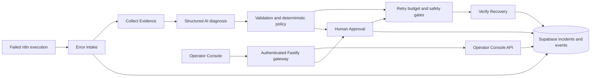

# Architecture

Panoptes OS witnesses automation failures, builds an evidence-based diagnosis, applies deterministic recovery policy, and records the resulting decisions. AI recommends; workflow code authorizes. The React console observes backend state and submits deliberate operator decisions.

## Responsibilities and contracts

| Component | Responsibility |
| --- | --- |
| Error Intake | Normalize failure identity/timestamps, resolve trusted configuration, collect evidence, validate diagnosis, route policy, persist lifecycle updates/events |
| Collect Evidence | Read failed execution, workflow metadata and previous successful execution through the n8n API; produce a focused evidence bundle |
| Write Incident Event | Validate event payload, check for an existing event, write or return the duplicate result |
| Retry Execution | Validate input, enforce integer retry budget and retry-safety rules, request an n8n execution retry |
| Verify Recovery | Inspect the retry execution, distinguish success/error/pending/canceled/crashed outcomes, enforce loop termination |
| Human Approval | Validate decision, read authoritative incident state, persist operator decision, route rejection or guarded recovery |
| Operator Console API | Project incidents, detail/event timeline and dashboard summary into the existing browser contracts |

The optional Sandbox Failure Generator deliberately raises a synthetic timeout with possible duplicate side effects. It is a demonstration fixture, not a payment integration. [Workflow import requirements](../workflows/README.md) describe its Error Intake mapping.

## Incident lifecycle and persistence

Incident identity is deterministic: `INC-<workflow_id>-<execution_id>`. Intake captures factual execution evidence before diagnosis. Trusted configuration comes from `panoptes_workflow_config`; missing configuration disables Panoptes/automatic recovery/idempotency and gives a zero retry budget. Invalid budgets fail validation.

Typical branches are:

- `NEW` → diagnosis → `ESCALATED`, `WAITING_FOR_APPROVAL`, or `RECOVERING`.
- Approved recovery → budget/safety gates → retry → `VERIFYING` → `RECOVERED`, `RECOVERY_PENDING`, or `ESCALATED`.
- Rejection → `ESCALATED` with `REJECTED` approval status and an `APPROVAL_REJECTED` event.

These are representative branches, not a promise that every incident visits every state. Pending verification is not success. `RECOVERY_PENDING` indicates remaining work; it does not prove an autonomous scheduler is running.

Current state is persisted in `panoptes_incidents`. Event records in `panoptes_incident_events` preserve diagnosis, approval, retry and outcome evidence. `panoptes_incident_observability` supports summary reads. The event writer uses deterministic identity and duplicate detection. This is workflow-level audit evidence, not a claim of cryptographic tamper resistance or transaction-wide exactly-once processing. Historical row/event anomalies remain preserved rather than silently corrected.

## AI authority and deterministic policy

The Groq-backed model receives trusted diagnostic constraints separately from untrusted execution evidence. The prompt forbids obeying instructions embedded in errors, names, node data or API responses. A structured parser and validator allow only diagnostic fields, reject additional runtime/control fields and inconsistent security claims, and reconstruct output without spreading arbitrary model data into trusted state.

AI cannot change credentials, workflow configuration, retry budgets, permissions, idempotency guarantees, approval status or business data. It cannot execute recovery tools or approve its own recommendation. A prompt boundary alone is not a security guarantee; validation and independent execution gates provide the enforcement layers.

| Failure type | Policy behavior before downstream execution gates |
| --- | --- |
| `RATE_LIMIT` | Automatic retry only for recommended RETRY, SAFE classification, NONE/LOW side-effect risk and no human requirement; otherwise escalate |
| `DEPENDENCY_UNAVAILABLE` | Same automatic prerequisites; conditional safety, medium/high risk or a human requirement can route to approval; otherwise escalate |
| `REQUEST_TIMEOUT` | Same automatic prerequisites; otherwise require approval because the remote operation may already have completed |
| `AUTH_FAILURE`, `INVALID_DATA`, `UNKNOWN` | Escalate |

Hard overrides block UNSAFE retries, prevent unknown risk from gaining automatic authority, and route automatic recovery to approval when trusted configuration disables it.

The Retry Execution subworkflow independently requires non-negative integer counts and `retry_count < max_retries`. UNSAFE always blocks. Otherwise trusted idempotency permits repetition; ordinary automatic safety requires SAFE plus NONE side-effect risk; CONDITIONAL requires explicit APPROVED status. These checks are intentionally separate: passing the policy stage does not guarantee that the execution gate allows a retry. Human approval cannot increase the budget or override UNSAFE.

## Operator Console and gateway

The console offers Light/Dark/System themes, summary metrics, recent/awaiting-approval lists, incident detail, execution evidence, diagnosis, recovery constraints, event timeline and confirmation dialogs. Backend statuses and timestamps remain authoritative. The browser API base is fixed to `/api/panoptes`.

| Gateway route | Internal operation |
| --- | --- |
| `GET /api/panoptes/session` | Authorized identity; no workflow call |
| `GET /api/panoptes/incidents` | `/webhook/panoptes/incidents` |
| `GET /api/panoptes/incident?incident_id=...` | `/webhook/panoptes/incident?incident_id=...` |
| `GET /api/panoptes/summary` | `/webhook/panoptes/summary` |
| `POST /api/panoptes/approval` | Advisory detail read, then `/webhook/panoptes/approval` |

Public approval JSON contains exactly `incident_id` and `decision` (`APPROVE` or `REJECT`). The gateway derives `operator` from verified Auth identity and injects server-only Header Auth. Preflight rejects missing/stale incidents but cannot reserve an incident or guarantee the POST succeeds. n8n remains authoritative for concurrent decisions.

The gateway never retries an approval POST. A lost acknowledgement remains uncertain; the operator must read backend state before another deliberate action. It does not infer a successful decision from an opaque failure. See [security](security.md), [verification evidence](testing.md) and [production boundary](production.md).
